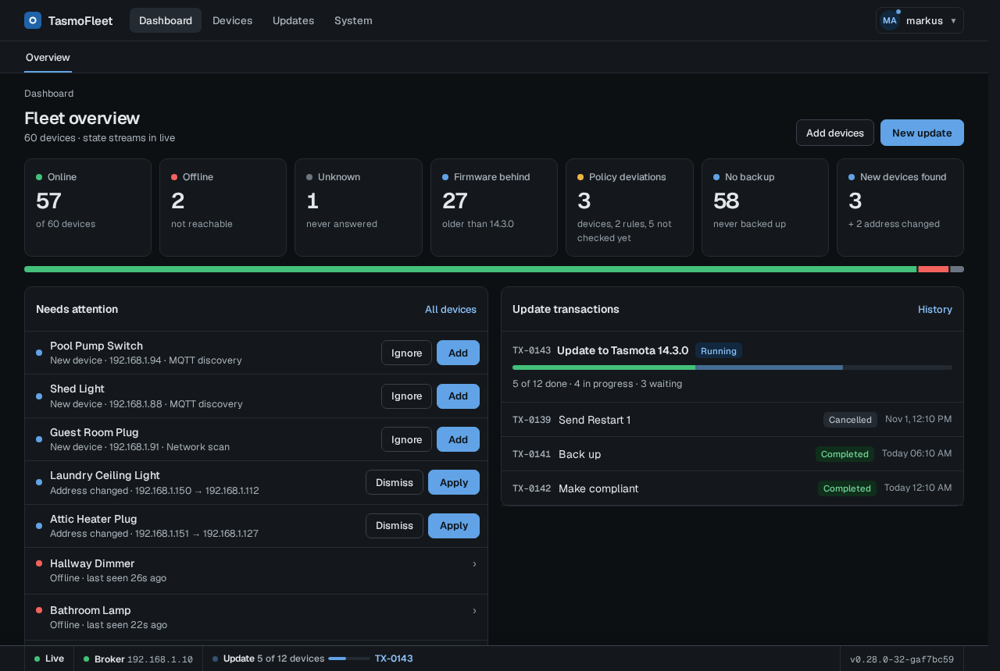
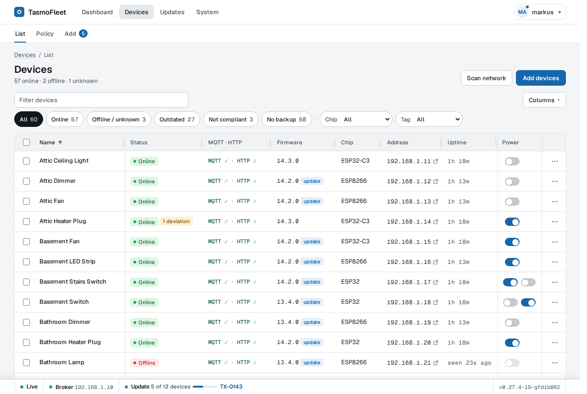
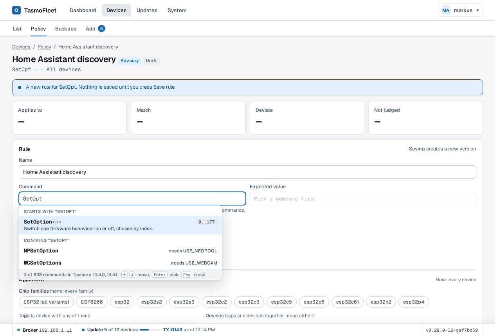
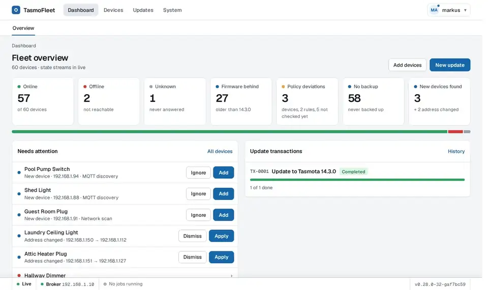

<p align="center">
  <picture>
    <source media="(prefers-color-scheme: dark)" srcset="assets/branding/wordmark-dark.svg">
    
  </picture>
</p>

<p align="center">
  <strong>Back up, check and update your Tasmota devices from one place, on your own server.</strong>
</p>

<p align="center">
  <a href="https://github.com/hellwand/tasmofleet/releases"></a>
  <a href="https://hub.docker.com/r/nofuturekid/tasmofleet"></a>
  <a href="LICENSE"></a>
  <a href="https://github.com/hellwand/tasmofleet/actions/workflows/main.yml"></a>
</p>

<p align="center">
  <a href="https://hellwand.github.io/tasmofleet/">Website</a> ·
  <a href="https://hellwand.github.io/tasmofleet/demo/">Live demo</a> ·
  <a href="#quick-start-docker">Install</a> ·
  <a href="#documentation">Docs</a> ·
  <a href="https://github.com/hellwand/tasmofleet/releases">Release notes</a> ·
  <a href="https://github.com/hellwand/tasmofleet/discussions">Discussions</a>
</p>



TasmoFleet is a self-hosted fleet manager for [Tasmota](https://tasmota.github.io/) devices, one Go
binary with an embedded SQLite database. All screenshots show simulated devices; the
**[live demo](https://hellwand.github.io/tasmofleet/demo/)** is the real UI with a simulated fleet of 60
devices, saved as static pages (actions are disabled).

## Why TasmoFleet

Built on a home fleet of a few dozen devices, as an alternative to
[TasmoAdmin](https://github.com/TasmoAdmin/TasmoAdmin) (it imports its device list).

- **Backups with diff and restore**: the raw `.dmp` plus decoded JSON, scheduled and before every
  update, compared side by side, restored onto the same or a replacement device.
- **Policy and compliance**: rules such as `PowerOnState 0` or `TelePeriod 300` per chip family, tag
  or device, a drift view per device, and "Make compliant" as one transaction.
- **Safe bulk firmware updates**: persisted server-side jobs (closing the browser does not stop
  them), bounded parallelism, and a guard before every `OtaUrl` and `Upgrade` that refuses unknown
  hardware, a chip-family mismatch, safeboot images and a variant change you did not choose.
- **MQTT, optional**: live state and pages that update without reloading; without MQTT every
  feature works over HTTP polling.
- **Notifications** by webhook (for example Home Assistant) or email when an update finishes or a
  scheduled backup or snapshot fails.
- **Sign-in** with OIDC single sign-on, trusted forward-auth headers or local accounts; roles and an
  audit log of every change.
- **Nothing changes on a device on its own**: background work only reads. See
  [what TasmoFleet changes on your devices](docs/device-changes.md).

Also: discovery via MQTT or HTTP scan, Prometheus metrics, light and dark theme, phone layout,
import from TasmoAdmin.

| Device list                                                                   | Policy rule editor                                                                                 |
| ----------------------------------------------------------------------------- | -------------------------------------------------------------------------------------------------- |
|  |  |



## Quick start (Docker)

```sh
docker run -d --name tasmofleet \
  -p 8443:8080 -p 80:80 \
  -e TZ=Europe/Berlin \
  -v tasmofleet-data:/data \
  nofuturekid/tasmofleet:latest
docker logs tasmofleet 2>&1 | grep -o '/setup/account?token=[^"]*'
```

Open `https://<host>:8443` followed by the printed `/setup/account?token=...` path, accept the
self-signed certificate, set the admin password and follow the setup. Port 80 serves firmware to
the devices over plain HTTP; set the URL they use on the System settings page.

With Docker Compose:

```yaml
services:
  tasmofleet:
    image: nofuturekid/tasmofleet:latest
    container_name: tasmofleet
    restart: unless-stopped
    ports:
      - "8443:8080" # UI (HTTPS, self-signed; container port is always 8080)
      - "80:80" # firmware for the devices (plain HTTP)
    environment:
      TZ: "Europe/Berlin"
    volumes:
      - tasmofleet-data:/data
volumes:
  tasmofleet-data:
```

The setup link is then in `docker compose logs tasmofleet`. Images are on Docker Hub and
`ghcr.io`, for amd64 and arm64. Bind mounts, registries, architectures and upgrading:
[docs/installation.md](docs/installation.md).

**Unraid**: install **TasmoFleet** from Community Applications (search for it in the Apps tab).
A manual template is in [deploy/unraid/tasmofleet.xml](deploy/unraid/tasmofleet.xml).

**Home Assistant app**: experimental and not published yet (no sidebar entry, no Home Assistant
sign-in). The app and its documentation are in
[deploy/homeassistant/tasmofleet](deploy/homeassistant/tasmofleet/DOCS.md).

## Backing up TasmoFleet

Back up the whole data directory (the `/data` volume): it holds the database and the device
backups. System, Snapshots downloads a consistent database snapshot, and scheduled snapshots are
possible. How to take, schedule and restore them:
[docs/backing-up.md](docs/backing-up.md).

## Documentation

- [Installing](docs/installation.md), [upgrading](docs/upgrading.md), [configuration](docs/configuration.md)
  (every environment variable, TLS, time zone, Home Assistant app)
- [Backing up TasmoFleet](docs/backing-up.md) and [emergency access](docs/runbooks/emergency-access.md)
- [What TasmoFleet changes on your devices](docs/device-changes.md), including the two roles
- Reverse proxy, OIDC (Authentik), Prometheus, Grafana and Unraid examples: [deploy/](deploy/)
- Design and behaviour: [spec](docs/spec/2026-10-18-tasmofleet-design.md); security notes per
  feature: [docs/security/](docs/security/); research: [docs/research/](docs/research/)
- [CHANGELOG](CHANGELOG.md), [ROADMAP](ROADMAP.md), [development](docs/development.md)

## Status

**Pre-1.0, single maintainer.** It runs a home fleet of a few dozen devices every day, but breaking
changes are to be expected before 1.0: read the [CHANGELOG](CHANGELOG.md) before updating. Your data
is migrated forward; configuration and routes may change. Questions and ideas are welcome in
[Discussions](https://github.com/hellwand/tasmofleet/discussions), bug reports in the
[issues](https://github.com/hellwand/tasmofleet/issues).

## How it is built (AI disclosure)

TasmoFleet is built with [Claude Code](https://claude.com/claude-code): most code, tests and docs
were written by it. The maintainer sets direction, reviews the changes and tests them on a real
fleet of Tasmota devices. The safety-critical parts (firmware selection, the OTA state machine) run
under mutation testing in addition to unit, integration and Playwright tests against a device
simulator.

TasmoFleet is an independent project and is not affiliated with, endorsed by or sponsored by
Tasmota or its maintainers. "Tasmota" is the name of the firmware this tool manages; the TasmoFleet
logo is original and unrelated to the Tasmota logo.

## License

[GNU Affero General Public License v3.0 or later](LICENSE) (`AGPL-3.0-or-later`). If you run a
modified version as a network service, you must offer its source to its users; the About page links
to the source code. Third-party notices are in [NOTICE](NOTICE).
