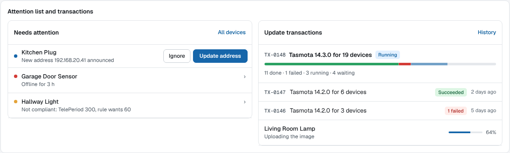
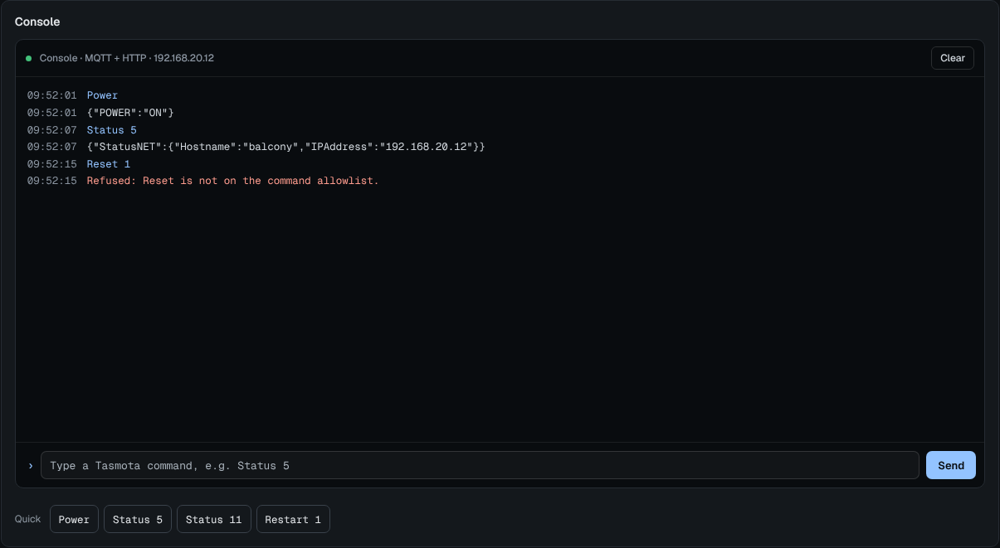

<p align="center">
  <picture>
    <source media="(prefers-color-scheme: dark)" srcset="assets/branding/wordmark-dark.svg">
    
  </picture>
</p>

# TasmoFleet

A fleet manager for [Tasmota](https://tasmota.github.io/) devices: inventory, health,
firmware updates, configuration backups and fleet-wide commands, in one static Go binary
with an embedded SQLite database. Intended as a modern replacement for TasmoAdmin.
Automation stays in Home Assistant (or wherever you run it).

TasmoFleet is an independent project and is not affiliated with, endorsed by or sponsored
by Tasmota or its maintainers. "Tasmota" is the name of the firmware this tool manages; the
TasmoFleet logo is original and unrelated to the Tasmota logo.

## Status

**Pre-1.0 (v0.11.x).** It runs a home fleet of a few dozen devices every day, but expect
breaking changes before 1.0; they are listed in [CHANGELOG.md](CHANGELOG.md). Your data is
migrated forward; configuration and routes may change.

## Features

- **OTA updates** as a persisted, restart-safe state machine: 1 MB ESP8266 devices go
  through `tasmota-minimal` first, ESP32 devices update directly, and a hard guard refuses
  any image built for a different chip family. Power states are restored afterwards.
- **Firmware** from upstream (GitHub releases, ota.tasmota.com) or your own uploads,
  cached, checked by its image header and served to devices over plain HTTP.
- **Backups** of the raw `.dmp`, plus decoded JSON when
  [decode-config](https://github.com/tasmota/decode-config) is available (bundled in the
  image); diff and restore, also onto a replacement device.
- **Fleet policy**: rules such as `PowerOnState 0`, a drift view and a one-click
  "make compliant" transaction.
- **Discovery** via MQTT and HTTP scan, TasmoAdmin import, power control, console and bulk
  commands, audit log, Prometheus metrics.
- **MQTT is optional**: every feature works over HTTP alone.
- **Sign-in** with OIDC or trusted forward-auth headers, or standalone local accounts with
  TLS; a local break-glass admin can be reset from the CLI.
- Works behind a reverse proxy under a base path.

| Needs attention and transactions | Device console |
| --- | --- |
|  |  |

Screenshots come from the built-in style guide with demo data.

## Quick start (Docker)

```sh
docker run -d --name tasmofleet \
  -p 8443:8443 -p 80:80 \
  -e TASMOFLEET_LISTEN=:8443 \
  -e TASMOFLEET_TLS_SELF_SIGNED=true \
  -v tasmofleet-data:/data \
  ghcr.io/nofuturekid/tasmofleet:latest
docker exec tasmofleet cat /data/initial-admin-password
```

Open `https://<host>:8443/`, accept the self-signed certificate, sign in as `admin` with the
password above (you must change it), and follow the setup. Port 80 serves firmware to the
devices (they fetch it over plain HTTP); it can be any port the devices can reach.

Behind a reverse proxy, run plain HTTP on `:8080` with `TASMOFLEET_TRUSTED_PROXIES` and
`TASMOFLEET_PUBLIC_URL` instead. The environment only holds bootstrap settings; everything
else is set in the UI. See [deploy/unraid/tasmofleet.env.example](deploy/unraid/tasmofleet.env.example)
for the full list, [deploy/](deploy/) for reverse-proxy, OIDC, Prometheus and Unraid
examples, and [docs/runbooks/emergency-access.md](docs/runbooks/emergency-access.md) for
lost passwords.

## Documentation

- Design and behaviour: [docs/spec/2026-10-18-tasmofleet-design.md](docs/spec/2026-10-18-tasmofleet-design.md)
- Security notes per feature: [docs/security/](docs/security/)
- Research (Tasmota OTA behaviour, TasmoAdmin lessons): [docs/research/](docs/research/)
- Roadmap: [ROADMAP.md](ROADMAP.md)

## Development

```sh
make check   # templ, fmt, vet, staticcheck, golangci-lint, unit tests, govulncheck, build
make ci      # everything CI runs, incl. race, integration, mutation and e2e tests
```

Requires Go 1.27. The e2e tests need Node.js (`make e2e-deps`, then
`npx playwright install chromium` once). See [CONTRIBUTING.md](CONTRIBUTING.md) and
[CLAUDE.md](CLAUDE.md) (rules for AI agents and humans).

## How it is built

TasmoFleet is written with heavy use of AI: most code, tests and docs were produced with
[Claude Code](https://claude.com/claude-code). The maintainer sets direction, reviews and
tests it on a real fleet. The safety-critical parts (firmware selection, the OTA state
machine) run under mutation testing in addition to unit, integration and Playwright tests.

## License

[GNU Affero General Public License v3.0 or later](LICENSE) (`AGPL-3.0-or-later`). If you
run a modified version as a network service, you must offer its source to its users; the
About page links to the source code. Third-party notices are in [NOTICE](NOTICE).
