# TasmoFleet design system

Status: binding since the design v2 port. The look is the
**Claude Design v2 prototype** ("v2"): rounded 7/10/12 px surfaces, hairline borders, Geist and Geist
Mono, one blue accent (`oklch` hue 250), light and dark as equal themes. The prototype
(`design/v2/`) is the binding source and is compared pixel by pixel (`make visual`, see
`design/v2/README.md`); the v1 Modernist component layer (`.button`, `.badge`, `.card`, `.empty-state`,
`.stats`, `.tabs`, `.theme-switch`, `.navpanel`, `.tone-info`, `.tone-bad`) was removed from `app.css` (#1069):
`TestNoPreV2ComponentSelectors` in `internal/web/legacycss_test.go` fails when one of them comes back in the
stylesheet or in a template, and `TestBulkBarIsOneBlock` keeps the bulk bar in one block. `.notice` and the
`.tone-ok`, `.tone-warn` and `.tone-neutral` banner classes are still used (#1091 and #1102 replace them).
Wording follows the prototype
(plan D14) except for the rows of the wording table below.

This document is the style guide in the repository: tokens, type, spacing, every component with its
variants and states, the usage rules and the deviations. The same components live on the page
**`/styleguide`** (System → Styleguide, and linked from About), open to every signed-in user: it shows
sample data only (D17). If a component is not on the style guide, it is not part of the design system.

## Where things live

| What | Where |
| --- | --- |
| Tokens | the top of `internal/web/static/app.css`: theme-independent `:root`, then the light block, the no-JS `prefers-color-scheme` block and the explicit dark block |
| Shell | templ `ui.Shell` (`internal/web/ui/shell.templ`): top bar, sub-navigation, user menu, phone header, drawer, crumbs, live indicator and banners, toast region; one navigation model (`ui/nav.go`) feeds all of them |
| Components | `internal/web/ui/components.templ` (props in `components.go`), CSS block "Components (design v2, WP F4)" in `app.css` |
| Style guide page | `internal/web/styleguide.templ` (`sgSections` lists the sections), route `GET /styleguide` |
| Style guide screenshots | `docs/design/styleguide/`, written by `make styleguide-docs` |
| Pages without a prototype screen | templ pages built from the components (plan 3.3), e.g. the notice page (`messagepage.templ`) and the retry page; the live device cells are `cells.templ` |
| Tables, Columns chooser, bulk bar | `tableprefs.go`, `tables.js`, `select.js`, the bulk bar partials (WP F5) |
| Prototype source | `design/v2/` (`template.html`, `prototype-tokens.css`; the self-contained bundle is kept outside the repository) |
| Fonts | `internal/web/static/geist-latin*.woff2`, `geist-mono-latin*.woff2` (OFL, see `NOTICE`), same origin; versioned with `?v=<hash>` and preloaded |

## Tokens

Names are the prototype's with the app's `--color-` prefix (`--bg` is `--color-bg`). Values are copied
verbatim, `oklch()` included. Light is `:root, [data-theme="light"]`; dark is
`:root[data-theme="dark"]`, `[data-theme="dark"]` and, for the no-JS fallback,
`@media (prefers-color-scheme: dark) { :root[data-theme-auto] }`. "same" means the dark theme does not
redefine the token. `tokens_test.go` parses this table, `app.css` and the prototype's token lines and
fails on any difference.

<!-- tokens:start -->
| Token | Light | Dark |
| --- | --- | --- |
| `--color-bg` | `#f4f5f7` | `#0d1013` |
| `--color-surface` | `#fff` | `#14181c` |
| `--color-surface-2` | `#f0f2f4` | `#1a1f24` |
| `--color-surface-3` | `#e5e8ec` | `#242a31` |
| `--color-border` | `#dfe3e7` | `#262c33` |
| `--color-border-strong` | `#c2c9d0` | `#3a424b` |
| `--color-control-border` | `#808a94` | `#68737f` |
| `--color-text` | `#13171c` | `#e4e7ea` |
| `--color-text-2` | `#48535e` | `#a9b2bb` |
| `--color-text-3` | `#5c6772` | `#939da7` |
| `--color-accent` | `oklch(0.5 0.13 250)` | `oklch(0.7 0.12 250)` |
| `--color-accent-hover` | `oklch(0.44 0.13 250)` | `oklch(0.77 0.11 250)` |
| `--color-accent-bg` | `oklch(0.95 0.025 250)` | `oklch(0.27 0.05 250)` |
| `--color-accent-fg` | `oklch(0.45 0.13 250)` | `oklch(0.8 0.1 250)` |
| `--color-on-accent` | `#fff` | `#0b1015` |
| `--color-ok` | `oklch(0.63 0.14 155)` | `oklch(0.72 0.15 155)` |
| `--color-ok-fg` | `oklch(0.44 0.1 155)` | `oklch(0.8 0.13 155)` |
| `--color-ok-bg` | `oklch(0.95 0.035 155)` | `oklch(0.27 0.05 155)` |
| `--color-warn` | `oklch(0.76 0.14 75)` | `oklch(0.8 0.14 80)` |
| `--color-warn-fg` | `oklch(0.47 0.1 65)` | `oklch(0.85 0.12 85)` |
| `--color-warn-bg` | `oklch(0.96 0.045 85)` | `oklch(0.29 0.05 75)` |
| `--color-danger` | `oklch(0.58 0.19 27)` | `oklch(0.68 0.18 25)` |
| `--color-danger-fg` | `oklch(0.49 0.17 27)` | `oklch(0.8 0.13 25)` |
| `--color-danger-bg` | `oklch(0.96 0.025 27)` | `oklch(0.29 0.07 25)` |
| `--color-danger-solid` | `oklch(0.52 0.19 27)` | `oklch(0.55 0.17 25)` |
| `--color-neutral` | `#98a1ab` | `#6b7581` |
| `--color-neutral-fg` | `#4f5964` | `#b0b8c1` |
| `--color-neutral-bg` | `#eceff2` | `#242a31` |
| `--color-term-bg` | `#12161b` | `#090c0f` |
| `--color-term-fg` | `#d3d9df` | same |
| `--color-term-dim` | `#8b95a1` | same |
| `--color-term-cmd` | `#93c3ff` | same |
| `--color-term-err` | `#ff9d8f` | same |
| `--color-grip-hover` | `color-mix(in oklab, var(--color-accent) 30%, transparent)` | `color-mix(in oklab, var(--color-accent) 30%, transparent)` |
| `--shadow-lg` | `0 14px 44px rgba(16, 24, 32, 0.18), 0 2px 6px rgba(16, 24, 32, 0.08)` | `0 14px 44px rgba(0, 0, 0, 0.6)` |
| `--color-console-rule` | `rgba(255, 255, 255, 0.08)` | same |
| `--color-console-line` | `rgba(255, 255, 255, 0.14)` | same |
<!-- tokens:end -->

`--color-info*` does not exist: informational banners and badges use the accent set
(`--color-accent-bg` / `--color-accent-fg`), as the prototype's "info" toasts do. A filled destructive
button uses `--color-danger-solid`.

Theme-independent tokens (all on `:root`):

| Group | Tokens |
| --- | --- |
| Fonts | `--font-sans: "Geist", ui-sans-serif, system-ui, sans-serif`; `--font-mono: "Geist Mono", ui-monospace, Menlo, monospace`. Body is `400 14px/1.45` (`--fs-base`, `--lh-body`) |
| Type sizes | `--fs-h1` 22px (weight 600), `--fs-h2-lg` 15px, `--fs-h2` 14px, `--fs-h2-sm` 13px, `--fs-body` 13.5px, `--fs-ui` 13px, `--fs-meta` 12.5px, `--fs-small` 12px, `--fs-badge` 11.5px, `--fs-stat` 28px (the stat tile value, `600 28px/1`, tabular figures; measured in F4) |
| Radii | `--r-control` 7px, `--r-card` 10px, `--r-panel` 12px, `--r-banner` 9px, `--r-code` 8px, `--r-sm` 6px, `--r-badge` 5px, `--r-xs` 4px, `--r-pill` 999px; dots and avatars use `50%` |
| Spacing | `--sp-N` is N pixels, for the values the prototype uses: 1-12, 14, 16, 18, 20, 22, 24, 28, 32, 36, 40. The prototype is not on a 4px grid, nothing is rounded |
| Card gap | `--card-gap`: the space between sibling cards, down and across, on every page: card stacks, the device overview, its tile row. The value is 16 px (`--sp-16`); the token still reads `--sp-12` and the card stacks write 16 px directly until #1101 makes them one. `device-layout.spec.ts` fails when two cards come closer |
| Controls | `--ctl` 34px (40px on phones), `--ctl-sm` 32px (40px on phones), `--ctl-lg` 40px, `--ctl-pad` 14px, `--ctl-pad-sm` 10px |
| Layout | `--container` 1640px, `--page-pad: clamp(12px, 2.4cqw, 32px)`, `--gutter` 16px, `--hair-w` 1px |
| Inline values made tokens | `--backdrop`, `--shadow-knob`, `--shadow-bar`, `--color-console-rule` (theme independent), `--color-grip-hover` (per theme: it mixes the accent) |
| Layers | `--z-sticky` 10, `--z-menu` 20, `--z-header` 30, `--z-header-menu` 40, `--z-dialog` 1000, `--z-toast` 1001 |

More tokens. The ones marked "planned" do not exist in `app.css` yet; #1099 adds them and replaces the
literals they stand for.

| Group | Tokens |
| --- | --- |
| Bars | `--sb-line` 32px (status bar row; 44px on phones), `--sb-h` (row + safe area), `--header-h` (sticky header with sub-navigation) |
| Overlay | `--backdrop` for every `::backdrop`; planned: `--color-scrim: rgb(10 14 18)` mixed 50 % into `--color-bg` for the scrollbar gutter behind a modal |
| On colours | planned: `--color-on-danger: #fff` (danger-solid text), `--color-knob: #fff` (switch knobs), both themes |
| Focus | planned: `--focus-ring: 2px solid var(--color-accent)`, `--focus-offset: 2px`; inside a clipping container the offset is `-2px` |
| Motion | planned: `--dur-fast` 0.12s (hover, press), `--dur-base` 0.15s (switch knob, chevrons), `--dur-slow` 0.6s (progress width), `--pulse` 1.6s (live dot); all stop under `prefers-reduced-motion` |
| Other | `--lh-tight` 1.15, `--grid-cols` 12, `--busy-ring` (the busy indicator's ring) |

No element is a size container (F3 as built): `cqw` in `--page-pad` resolves against the viewport
width including the scrollbar, which is what the prototype's root measures, and fixed elements
(bulk bar, toasts, drawer) stay positioned against the window.

## Type

Body is `400 14px/1.45 var(--font-sans)`. Font sizes are the `--fs-*` tokens; a component writes
`font: <weight> var(--fs-x)[/<line-height>] var(--font-sans|--font-mono)`. Weights are 400, 500 and 600
only. A size that is not in the table below is not used; a new one needs a token and a row here. Most
declarations in `app.css` still write literal sizes and off-scale weights; #1100 moves them to the tokens,
adds the planned ones (`--fs-title-sm` 16px: dialog title and a card that is the page's subject;
`--fs-empty` 17px: empty state heading; `--fs-auth` 20px: sign-in card title; `--fs-error` 26px: error page
title; `--fs-word` 18px: a word as a tile value) and adds the guard. The recurring sizes:

| Use | Font |
| --- | --- |
| Page title (h1) | `600 22px/1.2`, letter-spacing -0.015em |
| Error page title | `600 26px/1.2`, -0.02em |
| Sign-in card title | `600 20px/1.2` |
| Dialog title | `600 16px/1.3` |
| Empty state heading | `600 17px` |
| Card and section heading (h2) | `600 14px` (`--fs-h2`); `600 13px` (`--fs-h2-sm`) in device overview cards; `600 15px` (`--fs-h2-lg`) in release notes only |
| Stat tile value | `600 28px/1` (`--fs-stat`), tabular figures, -0.02em |
| List rows, inputs | `400 13.5px` |
| Buttons, tabs | `500 13px` (primary `600 13px`); tabs and top-bar groups `500 13.5px` |
| Field labels, secondary lines | `500 12.5px` / `400 12.5px` |
| Help, error lines, hints | `400 12px` |
| Badges, counters | `500 11.5px` |
| Mono values (addresses, versions, ids) | `400 12.5px var(--font-mono)`; transaction ids `500 12px` |

## Spacing, shape and layout

- Spacing tokens are named by pixel value (`--sp-N`); the prototype is not on a 4 px grid and nothing
  is rounded. The gaps that recur: 8 between buttons, 10 inside cards, 16 between cards
  (`--card-gap`), 16 card padding and below the page header. Spacing in `gap`, `padding` and `margin`
  uses the `--sp-N` tokens, never a px literal (#1101 replaces the about 420 literals left).
- Radii: controls 7, cards 10, dialogs and the auth card 12, banners and toasts 9, code 8, menu items
  6, badges 5, pills 999, dots and avatars 50 %.
- Heights: controls 34 px (40 px on phones), small buttons 32, top bar 52, sub-navigation 40, phone
  header 56, row targets 44.
- `main` is at most 1640 px wide with `clamp(12px, 2.4cqw, 32px)` gutters and no bottom padding
  of its own: the room below the content is the body's (the status bar's height plus `--sp-16`,
  #773).
- Shadows: `--shadow-lg` for menus, dialogs, toasts and the phone status sheet; `--shadow-bar` for every bar
  fixed to the bottom edge (status bar, bulk bar, save bar, phone action bar); `--shadow-knob` for switch
  knobs. No other shadow is written (three bars still write theirs as a literal until #1099).

## Components

Every component is a templ component in `internal/web/ui/components.templ` with typed props (values
are text, templ escapes them; no `templ.Raw`, no style attribute) and one CSS block in `app.css`
("Components (design v2, WP F4)"). `/styleguide` shows each section below, the first three as the
prototype's UI-states screen; `make styleguide-docs` writes the screenshots embedded here
(`docs/design/styleguide/<section>-<desktop|phone>-<light|dark>.png`). `styleguide_doc_test.go` fails
when a section of `/styleguide` has no entry here or no screenshot, so run `make styleguide-docs` and
commit the images after changing a component.

### Inline banners

A dot, a bold lead, the text and at most one action, in the tones ok, accent (information), warn, danger and neutral (a state that is neither good nor bad, e.g. a deactivated user). A banner is at most 820 px wide (`.banner { max-width: 820px }`), also above a full-width table. Above the page content, under the page header (never above the crumbs and the title); a banner stays until its cause is gone. A failure the user has to act on is `role=alert`, everything else `role=status`. The shell's flash, the setup notice and the connection banners are banners too. Pages render banners only through `ui.Banner` and `ui.ErrorSummary` (about 25 hand-written banners and the second action on three pages go with #1091). `ui.ErrorSummary` is the danger banner of a rejected form and reads "Fix N field(s). Nothing was saved yet."; it shows only when two or more fields fail (#1098).

Component: `ui.Banner(BannerData{Tone, Title, Text, Action, Alert, ID})`. A lead that holds a time (the offline banner, "Offline since 2:17 PM.") takes it as `TitleAt` with its fallback `TitleAtText` and `TitleAfter`, so the browser shows it in its own zone; `ID` is the target of `aria-describedby` for a control that cannot act (#1072, #1082). An action that leads off TasmoFleet keeps its `Target` and `Rel` (`_blank`, `noopener noreferrer`) and says to a screen reader that it opens a new tab. The broker ACL notice is such a banner (`ui.BrokerACLNotice`, #1078): tone warn, the lead "Your MQTT broker has no ACL.", one sentence and the action "Set up the ACL" (the guide), the same on every page; where it stands is `docs/security/mqtt-transport.md` T18.

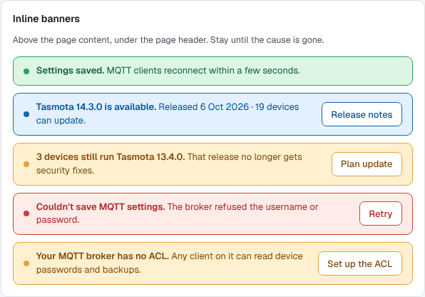

Also: [desktop, dark](../design/styleguide/banners-desktop-dark.png) · [phone, light](../design/styleguide/banners-phone-light.png) · [phone, dark](../design/styleguide/banners-phone-dark.png)

### Toasts

Bottom right, newest last. Success and information fade after 4.5 s; warnings and failures stay until dismissed and carry ×. Sources: the server flash after a redirect (an inline banner without JavaScript), the htmx event `toast` (`HX-Trigger`) and any button with `data-toast` (and `data-toast-tone`). The in-flow `ui.ToastStatic` (style guide) can show an action before ×; live toasts have none.

Component: `toast.js`, `ui.ToastStatic` (in the flow, style guide only).

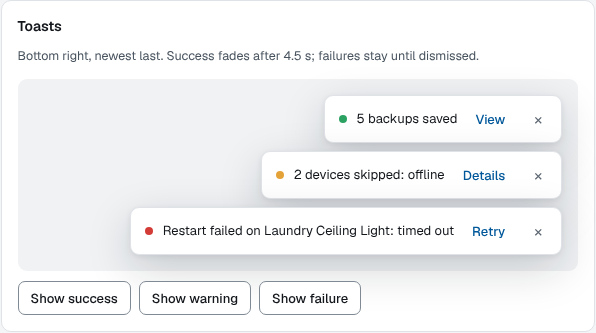

Also: [desktop, dark](../design/styleguide/toasts-desktop-dark.png) · [phone, light](../design/styleguide/toasts-phone-light.png) · [phone, dark](../design/styleguide/toasts-phone-dark.png)

### Live connection indicator

In the status bar at the bottom (the Live pill), only on pages that hold the event stream (S6). Live pulses green, Reconnecting... pulses amber faster and shows the warn banner with the attempt and the next try, Offline is red and shows the danger banner with Retry now. The pulse stops under reduced motion.

Component: shell (`live.js`), `ui.LivePill` (style guide).

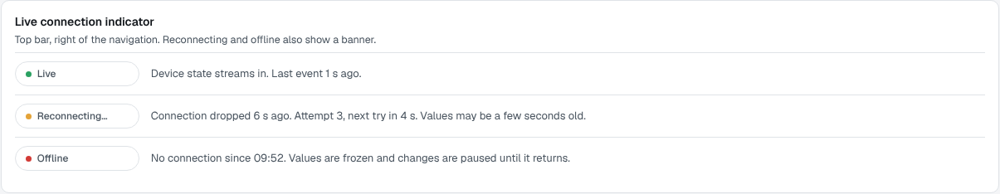

Also: [desktop, dark](../design/styleguide/live-desktop-dark.png) · [phone, light](../design/styleguide/live-phone-light.png) · [phone, dark](../design/styleguide/live-phone-dark.png)

### Buttons

Default (surface, strong border, `500 13px`), primary (accent, `600 13px`, padding 14), danger (outlined text in danger-fg), danger-solid (the confirming button of a destructive dialog), ghost, link (text only, 32 px target) and the icon button (⋯). Height `--ctl` (34 px, 40 px on phones), small 32 px. A Btn with `Href` is a link (it only navigates or opens the dialog named by `Dialog`); without it a `type=button` that never submits by accident. One action, one component; the confirming button repeats the trigger's verb and tone.

Component: `ui.Button(Btn{Label, Kind, Href, Rel, Target, Type, Name, Value, Small, Icon, Aria, Disabled, DisabledReason, ReasonID, ReasonShared, Dialog, Current, Mask})`. `Name` and `Value` make a submit button that sends a value (the console's quick commands); `Aria` is the accessible name of an icon button. `Rel` and `Target` belong to a link (a pager's `prev` and `next`; an external link's `noopener noreferrer` and `_blank`). `Current` marks the one a row of buttons is on (the pager's page size): `aria-current="page"` and the class `btn-current`, drawn in the selected look below. `Mask` is `data-visual-mask` for text the pixel comparison cannot reproduce (a version). `Disabled` is the native `<button disabled>`, for a button that is off for a moment and says nothing (a request in flight); a disabled link keeps `aria-disabled`. A button that cannot act now and has a reason sets `DisabledReason` (#1072): the blocked variant is `<button type="button" aria-disabled="true" aria-describedby="<id>">`, so Tab still reaches it, and the reason is visible text, never a `title` alone (a title shows on a mouse hover only). It carries no action (no `href`, `Dialog`, `Name`, `Value` or submit type), so pressing it does nothing with or without JavaScript. `ReasonID` is the id of the element that holds the reason: its own one-line `span.btn-why` under the button, or, with `ReasonShared`, a line the page shows already (the offline banner, one line that names several buttons such as "Restart and Back up: …"). A button the server always re-renders with its state (the device header, Retry failed, the user page, the Backups tab) uses the blocked variant; one the page follows live without a swap (Refresh identity) keeps its action and gets `aria-disabled` and its reason line from the server and from `live.js`. The click guard for such a button is the one in `select.js` (`[data-needs-device][aria-disabled="true"]`). A blocked button is drawn at half opacity like a disabled one, but while it has keyboard focus it is drawn at full strength (`button.btn[aria-disabled="true"]:focus-visible`, buttons only: an `aria-disabled` primary link such as "Update 0 devices…" keeps its half-opacity label), because the half opacity would cut the 2px focus ring to about 2:1 against the page, below the 3:1 a focus indicator needs. A blocked button in a page header (Retry failed) names a `p.pghead-why` line under the header (`ReasonShared`), so the header's buttons stay side by side.

Sizes: default (`--ctl`), small (`--ctl-sm`) and tall (`--ctl-lg`: the sign-in button and the update
preview's start button). A danger link is text in danger-fg for a row's Delete when the row has no other
button. A button that opens a dialog asking for more input ends with "…" ("Import…", "Make compliant…"); a
button that only asks for confirmation does not ("Restart", "Delete"). The tall size and the danger link
are not `Btn` options yet: #1092 adds them (`Size: Tall`, `Kind: DangerLink`) and their style guide samples.
The trigger of a destructive action is a default button (or the danger link in a row); its confirming
button is danger-solid and repeats the verb with the object ("Power off 6 devices"); a destructive dialog
opens with the focus on Cancel (#1093).

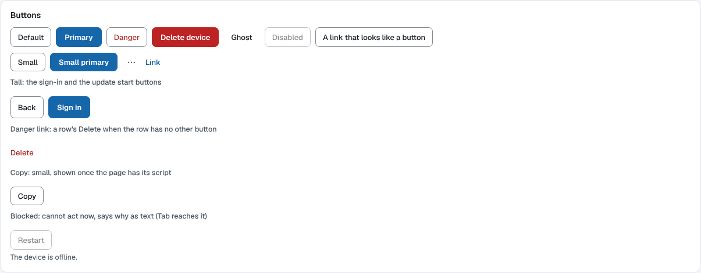

Also: [desktop, dark](../design/styleguide/buttons-desktop-dark.png) · [phone, light](../design/styleguide/buttons-phone-light.png) · [phone, dark](../design/styleguide/buttons-phone-dark.png)

### Badges, status dots and avatars

Badges are 20 px tinted labels (`500 11.5px`, radius 5) for states, results and counters. A status is a dot with its word (Online / Offline / Unknown), never the colour alone. Tones: ok, warn, danger, neutral, accent (`.t-*` classes); an unknown tone renders neutral. The avatar shows the initials; its colour follows the username, so a user keeps one colour everywhere.

A badge never leaves its cell: in a list, the badges of a row stack in their own cell, and the badge column is
at least as wide as the longest badge (the users list: 140 px, every row a subgrid of one column set).
On a phone a row with more than one badge (a role and Deactivated or Password change due) puts its badges side by
side on a line under the name instead; the name never gives way to a badge.

Badge labels are sentence case ("Update", "Failed"). A device's connection status is a badge with the dot
before the word, `ui.StatusBadge`, wherever it is shown (device list, device header, dashboard attention
list); the bare `ui.StatusDot` marks a tone where no status word is needed (stat tiles). `ui.StatusBadge`
is added by #1097.

A badge that stands for an outcome the user may want to tell apart without the colour carries a glyph before its
word: Create `+`, Merge `⇄`, Reject `–` in the import plan, `ui.BadgeMark(tone, mark, label)`. The glyph is
decoration (`aria-hidden`), the word is the label. A rejected row of an import is a warning, not a failure: it is the
input, and the rest of the plan goes on. A badge that needs a reason says it as text, not in a `title`: the Status
cell of the device list shows the short reason of every state but Online under its badge ("no message for over 11m",
"no answer", "login refused") and "MQTT down · HTTP only" in the badge itself; both come from the one entry of
`hints` (`internal/web/hints.go`) that also holds the tooltip. "Update 14.3.0" and "1 off policy" say which
update and what differs; the title repeats them as an extra.

Component: `ui.Badge(tone, label)`, `ui.BadgeMark(tone, mark, label)`, `ui.StatusDot(tone, label)`, `ui.Avatar(name, username)`.

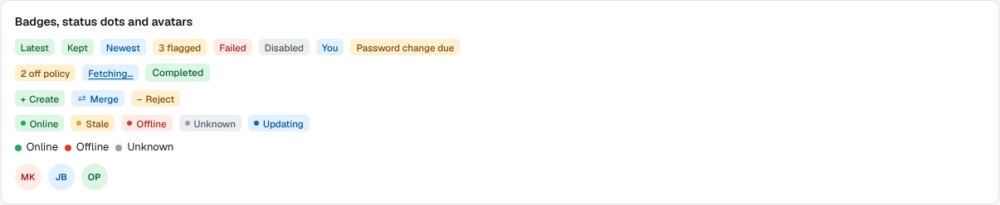

Also: [desktop, dark](../design/styleguide/badges-desktop-dark.png) · [phone, light](../design/styleguide/badges-phone-light.png) · [phone, dark](../design/styleguide/badges-phone-dark.png)

### Cards and key/value rows

A card is a surface with a hairline border and radius 10: padded (16 px, h2 `600 14px`, an optional line under it) or a list card (a header row with the title and a link, then rows separated by hairlines). Key/value rows are a 118 px label column and the value; addresses, MACs, versions and ids are monospace.

Component: `ui.Card(title, sub)`, `ui.ListCard(title, linkLabel, linkHref)`, `ui.KV(rows)`.

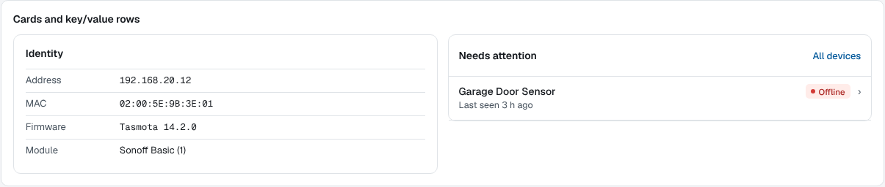

Also: [desktop, dark](../design/styleguide/cards-desktop-dark.png) · [phone, light](../design/styleguide/cards-phone-light.png) · [phone, dark](../design/styleguide/cards-phone-dark.png)

### Card stacks

Rule (maintainer, 2026-10-31, #391): in every card grid the cards stack directly under each other per column. A short card next to a tall one never leaves an empty gap below it, so a grid of cards is never laid out in aligned rows. A page lists its cards column by column; `ui.CardStacks(cols)` holds one `ui.CardStack(span)` per column (span 1 or 2 columns, or `ui.SpanAll` for a full-width stack). From 75 rem the stacks sit side by side, from 45 rem two balanced columns flow through the cards in document order, below that there is one column. A page whose cards do not balance in two half columns takes the full row for them (the Users list, the About components) or goes to one column between 45 and 75 rem (What's new, with the running version first), or keeps its stacks as two real columns between 45 and 75 rem because a self-refresh changes card heights and a card must not change sides (GPIO templates, #549). The document order is therefore the phone reading order: list the cards in the order a person should read them, or give a card another phone place with `ui.StackRank(n)` (`.r1` to `.r8`). The gap between cards is the 16 px token. A page never copies the CSS (`.cstacks`, `.cstack` in `app.css`); a new card grid uses the component. `e2e/tests/card-stacks.spec.ts` checks that no card has more than the gap above it within its column (`cardStackGaps`), at 1280, 1000, 600 and 375 px.

Component: `ui.CardStacks(cols)`, `ui.CardStack(span)`, `ui.StackRank(n)`. Used by the System Settings tabs (Notifications included), About, the Dashboard, the device Overview, the device Settings tab, Replace device, Users and What's new.

### Card widths follow their content

Rule (maintainer, #419): a card is as wide as its content needs, and a page fills the width the app gives it.

- **Content use.** Measured at 1280 px, a card that takes the full content width must use at least 60 % of it: its max-content width divided by its actual width. A card that uses less sits in a narrower column stack next to other cards (`ui.CardStacks`), not alone across the page. Deliberate exceptions carry a reason: the Relays card, the Console terminal, one-line bars (the device Settings save bar, the "Reset all settings" strip), and the Policy import/export card, which stays narrow. For a card that holds a list in several equal columns the rendered extent of its content counts too (the larger of the two figures), because the max-content width of such a list can be one column.
- **Page width.** A page uses the Dashboard's content width (1204 px at 1280, the app's capped content width on larger screens), never wider and never a fixed narrower card. The exceptions are the single-form and confirmation pages, which stay narrow on purpose: device edit, device delete, `ui.ConfirmPage` and add user. Replace device is not one of them: it uses the full content width. Banners keep their 820 px reading width above the stacks.
- **Transactions history** (61 % today) stays as it is; the guard lets it fall to 50 %, not further.

`e2e/tests/card-widths.spec.ts` (FULL tier) measures the pages it lists (the devenv fleet, `measureCards` in `e2e/support/card-widths.ts`) at 1280 px and fails for a full-width card under 60 %, for cards that do not span the content width, and, for a page that does span it at 1280, for cards that stop short of the capped content width at 1920 px (so a fixed `max-width` shows). A page breaks a rule only through an entry on the test's exemption list. The list is in blocks, one per reason: deliberate exceptions, narrow single-form pages, and one block per group of #419 pages not converted yet. A change that converts a group deletes its block; an entry whose page now passes fails the test, so the list cannot outlive the pages. Not measured: the narrow single-form and confirmation pages other than device edit (device delete, `ui.ConfirmPage`, add user), sign-in and first-run setup, error pages, states that need data the devenv fleet does not have (an empty fleet, the Replace preview, which needs a spare board of the same chip family and an old device that no longer answers: replace.spec.ts measures it), Drift (a table without a card), the phone and tablet widths (the card stacks have their own guard, `card-stacks.spec.ts`), and pages of other roles.

### Form fields

Label above (`500 12.5px`, text-2), the control (34 px, radius 7, strong border), then the help line (`400 12px`, text-3) or, when the server rejected the value, the error (`400 12px`, danger-fg) instead of the help. A rejected input carries `aria-invalid` and `aria-describedby` pointing at its message; validation stays on the server. Mono fields for addresses and ports. Forms lay out in a grid of 260 px columns (`gap 14px 18px`); the style guide sample is at most 820 px wide, the add-user form 760 px.

Component: `ui.Field(FieldData{...})`, `ui.SelectField`, `ui.ErrorSummary`.

A setting that has a stored value shows "Reset to default" after its label, in words on every field width (never a bare glyph), as a 24 px high target (a checkbox in a label: `clear.KEY`). Ticked, the control reads "Undo" (named "Undo reset to default" for a screen reader) and the field already shows the default; a second click brings the old value back. The control keeps the width of "Reset to default" in both states, so the row does not move when it is ticked. On a narrow field that shares its row with another one, a label row that cannot hold label, info button and the words wraps, and the control sits on its own line under a one-line label (the rule hangs on the control being there, never on its state). Typing in the field unticks it. The info button (ⓘ) after a label is drawn 16 px with a 24 px hit box (40 px on phones).

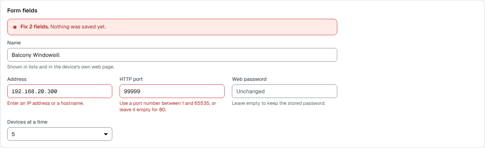

Also: [desktop, dark](../design/styleguide/forms-desktop-dark.png) · [phone, light](../design/styleguide/forms-phone-light.png) · [phone, dark](../design/styleguide/forms-phone-dark.png)

### Choices and switches

Radio cards (auth method, backup keep or drop) are `label > input[type=radio]` with a title and a line; the checked card takes the accent tint. Segmented controls (Advisory / Required, Operator / Admin, Side by side / Unified) are radio inputs in one frame, so they work without JavaScript; the theme switch in the shell is the same look. Checkboxes are 16 px in the accent colour. A setting switch is a checkbox with `role=switch` (38 x 22, knob `--shadow-knob`); the power switch of a row is 34 x 20 inside a 48 x 44 px target and disabled while the device is offline. A row's power switch is `role="switch"` with `aria-checked` (the state is never in its name) and is named by its row through `aria-labelledby`: the device name in the Name cell (`dvn-<id>`) and the page's hidden `relay N` text (`rly-N`), so the live fragment the stream sends needs no device name and carries no id of its own (#1074).

Component: `ui.RadioCards`, `ui.Segmented`, `ui.Check`, `ui.Toggle`, `ui.PowerSwitch`.

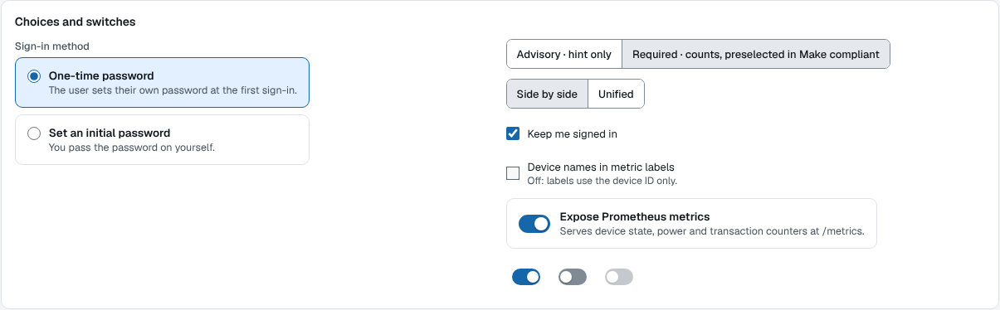

Also: [desktop, dark](../design/styleguide/controls-desktop-dark.png) · [phone, light](../design/styleguide/controls-phone-light.png) · [phone, dark](../design/styleguide/controls-phone-dark.png)

### Stat tiles and fleet health

A tile is a link to the filtered list: dot and label (`500 12.5px`), the value (`--fs-stat`, tabular figures) and a hint. Tiles sit in a grid of 150 px columns. The health bar shows online, offline and unknown as three segments; their widths come from the server as SVG attributes (no inline style under the CSP). Text meets WCAG AA in both themes (4.5:1; 3:1 only for text of 24 px or more, or 18.66 px bold and more): a number in a tone is coloured with the tone's `-fg` token, never with its fill (`--t`, `--color-*`), which is for dots, bars and backgrounds. The device overview and Policy header tiles (`.dev-tile-v`) follow this; `shell-css.spec.ts` guards it.

An info tile (Policy header, device overview) is not a link: label, value, hint and optionally a bar or up
to two small buttons. A number uses `--fs-stat`; a word ("Running", "MQTT · HTTP") uses `600 18px`
(`--fs-word`). Values in a tone use the tone's `-fg` token. Today it is the `.dev-tile` markup;
#1097 makes it the component `ui.InfoTile`.

Component: `ui.StatTile(StatTileData{...})`, `ui.HealthBar(ok, off, unk)`; `ui.ComplianceBar(match, deviate, unknown)` draws a policy rule's compliance the same way.

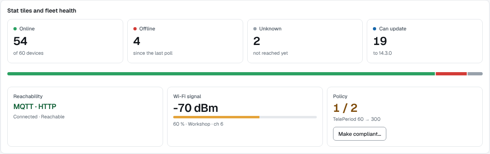

Also: [desktop, dark](../design/styleguide/tiles-desktop-dark.png) · [phone, light](../design/styleguide/tiles-phone-light.png) · [phone, dark](../design/styleguide/tiles-phone-dark.png)

### Attention list and transactions

"Needs attention" lists address-change proposals first, with two inline actions (POST forms with the CSRF token), then devices with a dot, the reason and ›. The transaction card shows id, title, state badge, the progress (done, failed, running; each state has its own shape, see Steps and progress) and a summary; history rows show id, title, result badge and age. A row's progress is a mini bar with the percentage.

Component: `ui.AttentionList`, `ui.TxnCard`, `ui.TxnRow`, `ui.SegBar`, `ui.MiniBar`.

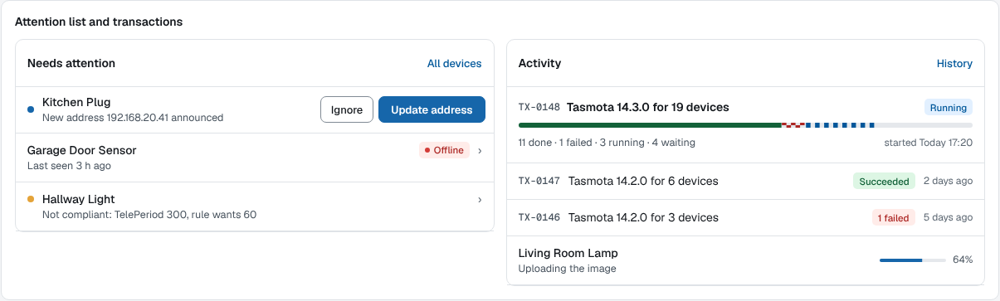

Also: [desktop, dark](../design/styleguide/lists-desktop-dark.png) · [phone, light](../design/styleguide/lists-phone-light.png) · [phone, dark](../design/styleguide/lists-phone-dark.png)

### Page header, crumbs and tabs

The page header is the h1 (`600 22px/1.2`), a subtitle line and the page's buttons on the right. The crumbs sit above it (`/` separators). One rule builds every trail (#1000): `ui.ShellData.Trail` puts the area (the lit top-bar group) and the lit sub-navigation tab in front, both read from the model that draws the tabs, and the page adds only its own steps (`Crumbs` is the end of the trail, never a full one). So the trail and the lit tab agree by construction, and a handler never types an area or tab label. The rules: (1) a page under a tab names that tab (`Devices / List / Bulk action`); (2) a device is reached from several tabs, so it hangs directly under the area and lights no tab (`Devices / kitchen / Edit`; nav key `device`), while a transaction lives on the Transactions tab (`Updates / Transactions / TX-0012`); (3) one name per place: System pages start with `System`, a device is named by its name, never "Device"; a page below a Settings tab names that tab (`System / Settings / Advanced / Reset`, label from `sysLayout`); (4) the trail shows where the page lives, not where the person came from (the way back is Cancel's job). A crumb is a link only when the person may open it, and System has no page of its own. `TestEveryTrailAgreesWithTheLitTab` holds the rules over the pages. Tabs are links with an underline (`inset 0 -2px 0` accent) and an optional count; a tab that cannot be used now is disabled with the reason as its title. On a phone the tab row scrolls sideways, and so does every filter chip row that does not wrap. A strip that scrolls shows that there is more (#1079): `tabs.js` sets `data-more-start` / `data-more-end` on the strip while there is more on that side (updated on scroll, on resize and when a swap brings a strip in), `app.css` fades that edge with a colour mask (`mask-image`, 32 px) and the selected tab or chip is scrolled to the middle on load. A strip that fits or wraps carries neither attribute and no fade; without JavaScript there is no fade. The phone's top bar names the area, the lit top-bar group (`ui.AreaLabel`: Dashboard, Devices, Updates, System), and never the page's own title: the bar is one line that cannot break at a word, so the page's name (a device's name, "Users" above the h1 "Users") is the h1 below and the bar does not repeat it. The setup steps keep their numbers on a phone and show only the current step's label, under the row; and the device header shows Restart and Back up there, with Edit, Replace device, a rule and Delete in one "⋯" menu (`hx-preserve`, so the live refresh does not close it); a wide screen shows the four buttons as before.

Component: `ui.PageHeader(title, sub)`, `ui.Crumbs(trail, base)`, `ui.Tabs(label, tabs)`.

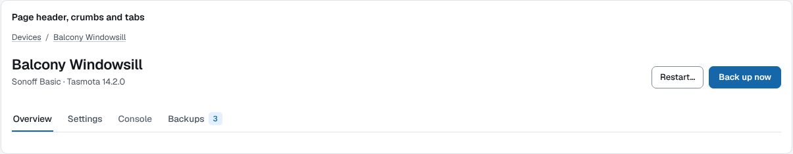

Also: [desktop, dark](../design/styleguide/tabs-desktop-dark.png) · [phone, light](../design/styleguide/tabs-phone-light.png) · [phone, dark](../design/styleguide/tabs-phone-dark.png)

### Menus

A row menu is a `
` with the ⋯ button and a 250 px panel (radius 10, `--shadow-lg`); items are links or buttons (`400 13px`), destructive ones in danger-fg after a rule, disabled ones in text-3 with the reason on a second line (a `<button type="button" aria-disabled="true">` that carries the reason in its own text and no action, so Tab still reaches it). It is a plain disclosure, not an ARIA menu: no `role="menu"` or `role="menuitem"` (they promise arrow keys and roving focus that `menu.js` does not have; a source test fails when a template claims them), and the trigger is named by its row, `Actions for <name>` (#1074). `menu.js` keeps one menu open, closes on Escape and on a click elsewhere; `up` opens above the button (the server marks the last rows, the script decides by the viewport). The style guide shows menus open in the flow with `data-static`, which every script leaves alone.

Component: `ui.RowMenu(label, items, up)`, the shell's user menu and drawer.

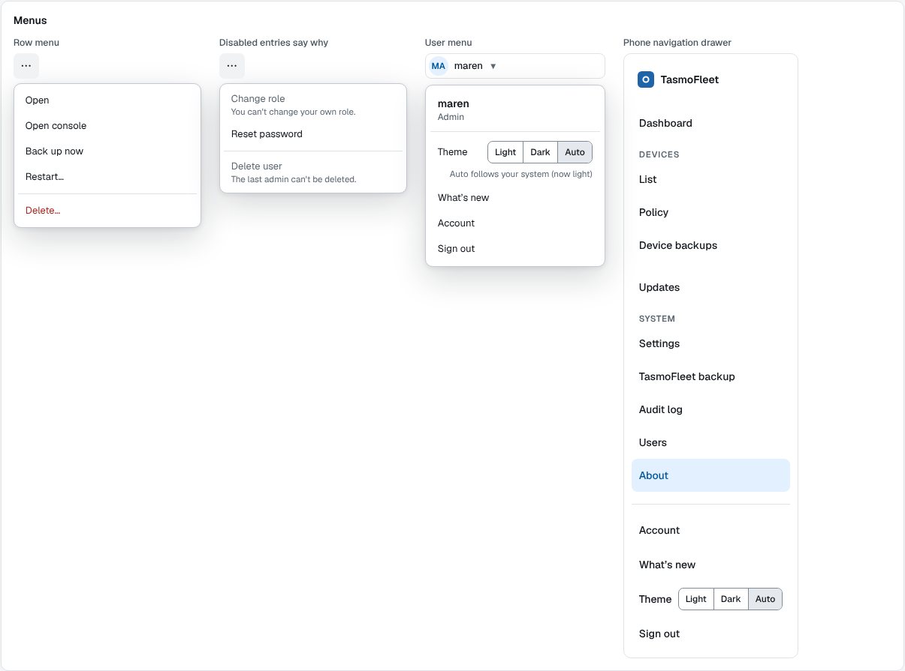

Also: [desktop, dark](../design/styleguide/menus-desktop-dark.png) · [phone, light](../design/styleguide/menus-phone-light.png) · [phone, dark](../design/styleguide/menus-phone-dark.png)

### Dialogs

A confirmation dialog has the title (`600 16px`), the consequence, optionally the list of what changes or a command input, Cancel and the verb (danger-solid for destructive actions, primary otherwise); it posts with the CSRF token. `dialog.js` opens it from any `[data-dialog]` and closes the menu it was opened from; without JavaScript the trigger's link goes to the confirmation page (`ui.ConfirmPage`, the same look). The step-up dialog ("Confirm it's you") offers the identity provider's re-authentication and, for local accounts, the password.

Component: `ui.Dialog(DialogData{...})`, `ui.StepUp(StepUpData{...})`, `ui.ConfirmPage(ConfirmData{...})`.

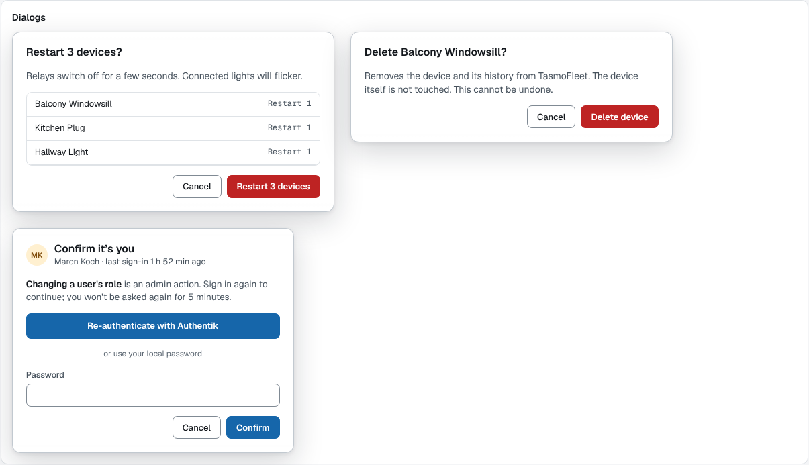

Also: [desktop, dark](../design/styleguide/dialogs-desktop-dark.png) · [phone, light](../design/styleguide/dialogs-phone-light.png) · [phone, dark](../design/styleguide/dialogs-phone-dark.png)

### Empty, no match and loading

An empty list shows an icon tile, a heading, one line and up to three buttons in a dashed frame. A filter without results says so and offers Clear filters. The skeleton is only for lazily loaded fragments (D12); server-rendered pages never show it. Its shimmer stops under reduced motion.

Component: `ui.Empty(title, text)`, `ui.NoMatch(text, clearHref)`, `ui.Skeleton(label, rows)`.

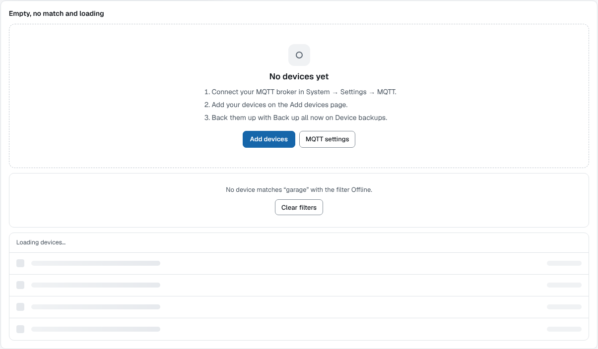

Also: [desktop, dark](../design/styleguide/states-desktop-dark.png) · [phone, light](../design/styleguide/states-phone-light.png) · [phone, dark](../design/styleguide/states-phone-dark.png)

### Error page

The status code (mono), a title (`600 26px`), what happened, the path that failed and two ways on. Used for 404, 403 ("Not allowed") and a feature that is switched off.

Component: `ui.ErrorPage(code, title, body, path, primary, secondary)`.

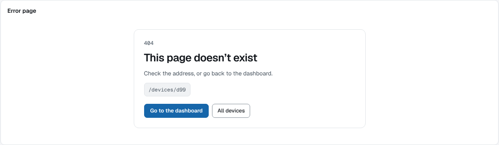

Also: [desktop, dark](../design/styleguide/errors-desktop-dark.png) · [phone, light](../design/styleguide/errors-phone-light.png) · [phone, dark](../design/styleguide/errors-phone-dark.png)

### Sign-in card

Sign-in, setup and password pages: the brand above, a 420 px card (radius 12, padding 24) with the h1 (`600 20px`), banners, fields and the button, and the footer "TasmoFleet x.y.z · host" in mono (D15).

The same card carries the short messages that come before any role is known, so they draw no navigation: a failed or refused single sign-on (`messagePage`) and the stale form (`stalePage`, #1084: "This page is out of date", a form whose sign-in changed since it was opened). Their ways on are one `ui.ButtonRow` of `ui.Button`s at the default size, the way back first and primary: Back to sign-in, then "Sign out of <provider>" (the provider's end-session link, only when it has one) on the refused sign-on; Reload (the page the form was on) and Dashboard on the stale form. The tall full-width size stays with the sign-in and password forms until #1092 makes it a `Btn` option.

Component: `ui.AuthCard(base, version, host)`.

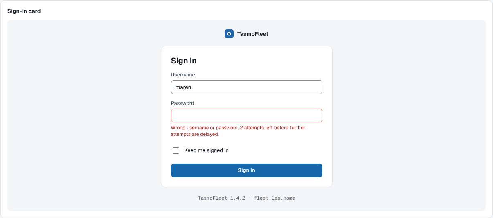

Also: [desktop, dark](../design/styleguide/auth-desktop-dark.png) · [phone, light](../design/styleguide/auth-phone-light.png) · [phone, dark](../design/styleguide/auth-phone-dark.png)

### Console

A dark panel (`--color-term-*`): a header with the live dot, the connection and Clear; timestamped lines (commands in term-cmd, refusals in term-err); the prompt form; quick commands are submit buttons that send their command (no JavaScript). The placeholder and the quick commands never offer `Status 0` (D9).

Component: `ui.Console(ConsoleData{...})`.

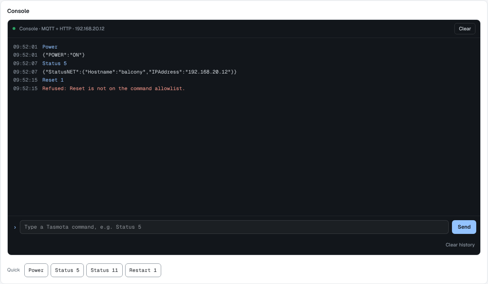

Also: [desktop, dark](../design/styleguide/console-desktop-dark.png) · [phone, light](../design/styleguide/console-phone-light.png) · [phone, dark](../design/styleguide/console-phone-dark.png)

### Backup comparison

Side by side (setting, older, newer; changed rows tinted warn) or unified (− and + lines in the danger and ok tints). The layout and "show all" are query parameters, so the comparison works without JavaScript.

Component: `ui.Diff(DiffData{...})`.

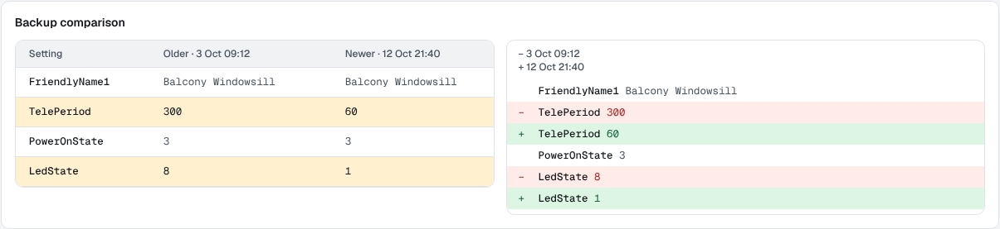

Also: [desktop, dark](../design/styleguide/diff-desktop-dark.png) · [phone, light](../design/styleguide/diff-phone-light.png) · [phone, dark](../design/styleguide/diff-phone-dark.png)

### Release notes

Headings, paragraphs, lists, code blocks and the breaking-change box in the warn tone. Release notes are text only: nothing from the feed becomes markup (the firmware/notes.go contract).

Component: `ui.Notes(blocks)`.

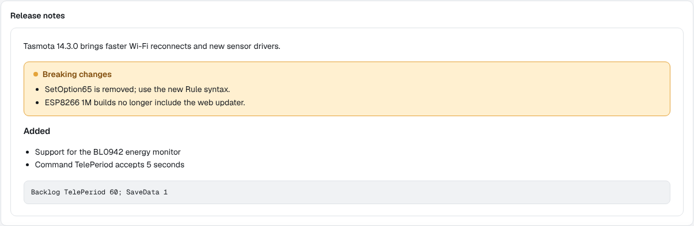

Also: [desktop, dark](../design/styleguide/notes-desktop-dark.png) · [phone, light](../design/styleguide/notes-phone-light.png) · [phone, dark](../design/styleguide/notes-phone-dark.png)

### Patterns without a style guide section yet

The sections below describe patterns the app uses every day that `/styleguide` does not show yet. Each gets
its style guide section, its screenshots and, where named, its component with the issue in brackets; until
then the rule here is the reference for new markup.

### Data tables

A table sits in a card frame edge to edge (no inner padding), with a hairline under the header and between
rows. Header cells are `500 12px` text-2, sentence case, no background band; a sortable header carries the
sort icon (3:1 against the header) and `aria-sort`. Rows are at least 44 px tall, cells `400 13.5px`, values
that are addresses, MACs, versions and ids in mono; an empty cell reads "-". At most two row actions, more go
into the row menu (⋯). Pinned columns, column widths and the Columns chooser come from `tableprefs.go`. Below
45rem a table either scrolls sideways (`.dense` tables with few columns) or turns into phone cards, one block
per row with label before value. A table without rows shows `ui.Empty` instead of a header.

Under the table: the pager: Previous, "Page 1 of 6, 139 events", Next, then the page sizes; all small
buttons (`ui.Button`, `Small`). A page that cannot be reached (Previous on the first page, Next on the last)
is a disabled button. The current page size is a link to the page you are on with `Current`: it uses the
selected state (`.btn-current`).

Component: `ui.Table`, `ui.Pager`, `ui.DeviceCards` (#1094).

### Chips and tags

A chip is a filter you can toggle: a pill (`--r-pill`), 28 px high (40 px on phones), `500 12.5px`, the
control border; a count after the label in text-2; checked uses the selected state. It is a
`label > input[type=checkbox|radio]`, so it works without JavaScript. A tag is a read-only outlined label
(`--color-border-strong`, radius 5, `500 11.5px`) for a kind or a source (Proxy, System, CLI, a device tag).
A tag never carries a state; a state is a badge.

Component: `ui.Chip(ChipData{Label, Count, Name, Value, Checked})`, `ui.Tag(label)` (#1095). They replace
`label.chip`, `.ucheck.chip`, `.dv-chip`, `.add-chip`, `.pol-pill` and `.tag`.

### Folds

`details.fold` holds something secondary: the summary is a `600 13.5px` line with a chevron on the right and
a 40 px target; closed at every width unless it has `open`. Inside a card the fold takes the card's width
and ends it. A card that is only a fold has the summary as its title.

### Bars fixed to the bottom

The status bar (`ui.StatusBar`, #307) is one `--sb-line` row at the bottom of every signed-in page: broker,
running jobs, backups, the Live pill and the version, each a 32 px item with a tone; on a phone one line that
opens a sheet. The bulk bar (device list), the backups selection bar and the save bar (settings, device
settings) sit one gap above it, are surface bars (never inverted), use `--shadow-bar` and never clip their
last button at 375 px. The save bar shows the unsaved dot inside the content edge to its left.

### Info button, copy button, file drop

The info button (ⓘ) sits after a label and opens a popover with one or two sentences; its hit box is 24 px
even where the drawing is 16 px. It is never the only place a rule is stated, and it never repeats the
field's help line: a field has a help line or an info button. The copy button is a small default button
"Copy" after the value, hidden without JavaScript; it confirms with a toast. A file drop zone is a dashed
`--color-border-strong` frame, radius 10, with "Drop a … here, or choose a file"; the file input is the link.

### Steps and progress

A multi-step flow (setup, new update) numbers its steps ("5 · When") in reading order; the current step is
accent, done steps carry ✓. Progress is `ui.SegBar` (done, failed, running; the segments differ by more than
hue and reach 3:1 against the track) or a native `<progress>` (flat, full width, accent fill, radius 2). In a
`ui.SegBar` done is one solid bar, running is vertical stripes with gaps and failed is a checker over two rows
(`segRects` in `ui/components.go`; each cell is 10 of the bar's 1000 units, 3 px at the narrowest), filled with the
tone's text colour (`--t-fg`), never dimmed. The fleet health bar and a rule's compliance bar still fill with `--t`
(2.2 to 2.7:1 on their track) and differ by hue only: open follow-up. The
stability sparkline is an SVG with sizes as attributes.

### Busy

A control that waits for a device (`aria-busy`, set by `form.js`) draws a ring (`--busy-ring`) after its
text; room for it is always kept, so nothing moves. A link to a page that reads a device first shows the
same ring until the page arrives.

## Usage rules (must not regress)

- **Theme.** `ui.Shell` renders `<html data-theme-auto>` unless the user chose Light or Dark (stored
  per user, D11). Dark tokens apply only under `:root[data-theme="dark"]` or, without JavaScript,
  under `prefers-color-scheme: dark` while `data-theme-auto` is present, so "Auto" follows the system
  live. The token blocks also select `[data-theme]`, so a part of a page can show the other theme.
- **CSRF.** A GET fallback never sits in a POST form that carries the `csrf` field. The
  fallback of a dialog trigger is a link (`a ... href=".../delete" data-dialog="..."`) or its
  own GET form without a token. No GET request of the app carries `csrf=` in its URL
  (`e2e/tests/design-port.spec.ts`, `deviceconfirm_test.go`).
- **Fixed bars stay inside the viewport.** The bulk bar never clips its last button at 375 px;
  layout guard (a) checks every fixed or sticky element.
- **Breakpoints** are rem, never px: phone up to `44.99rem` (720 px, the prototype's `S.w < 720`; the
  Columns chooser and `tables.js` use the same 45rem), tablet `45rem`-`74.99rem` (two balanced card
  columns), desktop from `75rem` (card stacks side by side). Component breakpoints: `60rem` (the bulk bar
  folds into one Actions menu), `72rem` (audit table layout, two-column settings grid). Any other width
  needs a line here with its reason. The app still has about 20 other queries and two in px;
  #1102 folds them into this list and makes `shell-css.spec.ts` fail on a px media query.
- **Tones.** There are five: ok, warn, danger, neutral, accent. The classes are `.t-ok` ... `.t-accent`;
  each sets `--t` (fill: dots, bars), `--t-bg` and `--t-fg` (text). Badges, dots, avatars, banners, toasts,
  notes and the status bar read these three variables. The names "bad", "info", "success" and "error" are
  not used (the parallel `.tone-*` classes go with #1102). One exception: the transaction bar (`ui.SegBar`)
  fills with `--t-fg`, because `--t` on its track measures 2.2 to 2.7:1 and a graphic needs 3:1 (#1073).
- **A title is an addition, colour is never the whole message.** A `title` attribute may repeat visible text,
  never be the only place that says something: a phone has no hover, a keyboard and most screen readers
  never show it. A state, a count's meaning or a failure's reason is text on the page (a word, a short
  line under the element); a state that is told only by a colour or a tint also carries a word, a glyph or a
  shape (#1073; `e2e/tests/title-only.spec.ts` checks the elements the issue names, not every title).
- **Selected.** A selected item that is not a tab (a toggled filter chip, the current page of a pager, the
  chosen release, a checked radio card) uses the accent tint: `--color-accent-bg` background,
  `--color-accent` border, `--color-accent-fg` text. A segmented control's checked segment is
  `--color-surface-3`. Tabs use the underline. Nothing is drawn inverted (text colour as fill)
  (#1096).
- **No opacity on content.** Stale, not judged, disabled rules and switched-off settings keep their text
  colours (AA in both themes) and say their state in words; only a control that cannot act takes the
  disabled look (#1071).
- **Components only through `ui`.** A page renders a button, badge, banner or card with its `ui.*`
  component, not with the component's classes. `ui_markup_test.go` (#1092) fails on `class="btn`,
  `"bdg`, `"banner` or `"ucard` outside `internal/web/ui`; its exemption list is in blocks per page group
  and only shrinks, like the card-widths list.
- **Folds.** `details.fold` holds something secondary and is closed at every width unless it has
  `open` (account and user editing, a rule's Unjudged devices).
  The system container settings are no fold any more (#350). The phone-only `details.m-fold` of the
  first design port is gone (#329).
- **Form errors sit at the input.** A handler that rejects a value sets the input's name
  (`ErrField`) next to a human sentence (`Error`). `ui.Field` (and a page's own inputs) mark that
  input (`aria-invalid`, `aria-describedby` to the sentence right after it), the focus goes there,
  and the page leaves its banner out, so the message appears once. Errors that belong to no input (rate limit,
  stale page, a failed device call) stay in the banner with no `ErrField`. Go error chains
  (`auth: ...`, `tasmota: ... HTTP 404`) never reach the browser: a small mapping per area turns
  them into copy (`auth.inputProblem`, `formProblem`, `ruleProblem`, `deviceProblem`), the details
  go to the log. Row forms that repeat per row keep their errors in the banner. `fielderror_test.go`
  guards the pattern on the pages.
- **One action, one component.** Actions are buttons; links only navigate. Destructive actions
  confirm exactly once, in the dialog (or its page without JavaScript), and the confirming
  button repeats the trigger's verb and tone.
- **No inline styles or scripts** (strict CSP). Colours, spacing, radii and type come from tokens.
- **A dialog shared by many rows** (the device list) is one `dialog#dlg-row` that `dialog.js`
  fills from the `data-dlg-*` attributes of the link that opened it, so the list does not carry
  a dialog per device. The device list does not reload while a menu or dialog is open or rows
  are selected (`select.js`).
- **Dialog openers.** Opening a dialog closes any open Actions menu (`dialog.js`). When the
  confirming verb is itself "Cancel ..." the opener sets `data-dlg-dismiss` ("Keep running") so
  the two buttons never read alike.
- **Fonts.** Geist and Geist Mono, self-hosted (`geist-*.woff2`, variable `wght`, SIL OFL 1.1,
  `geist-OFL.txt`). Kerning is the browser default, as in the prototype; the space after a capital
  keeps its width (`shell-css.spec.ts`).
- **Tokens are the prototype's.** Colours, shadows and the font stacks are copied value for value
  (`design/v2/prototype-tokens.css`); `tokens_test.go` fails when `app.css`, that file or the token
  table above differ. v1 names (`--color-success*`, `--color-divider`, `--space-*`, the generated ramps) do
  not exist and get no alias.

- **Navigation is the same for every role** (F4, S7). Every role sees all groups and pages; each page
  enforces its own permission (403). A group button leads to the first page the role may open, so it
  never ends on a 403 (an operator's System button opens the style guide). Feature switches still
  decide: a missing service has no page and no entry.
- **Components take text, not markup.** No `templ.Raw`, no style attribute, no inline script; sizes
  from data are SVG attributes. `components_test.go` feeds a hostile string through every
  text-carrying component.

## Wording

The prototype's wording is the default (D14); the product name is "TasmoFleet" in all UI and docs text
(D15). The deliberate changes (kept in sync with the plan, section 0.1):

| Prototype term | Our term | Reason |
| --- | --- | --- |
| Enforce (policy severity) | Required | "Enforce" suggests TasmoFleet writes the value to devices. It never does: a deviation is counted and preselected for Make compliant. |
| Warn (policy severity) | Advisory | Our `warn` is the stronger level; reusing the word would invert its meaning. |
| `Status 0` (console quick command and placeholder) | `Status 5` | Safety rule 2: `Status 0` bursts corrupt ESP8266 heap and replies (D9). |
| "tasmofleet" (product name in text) | TasmoFleet | D15. Identifiers stay lower case. |

Results, ids and dates (one word per thing; #1105 and #1104 bring the app in line):

| Thing | Write | Never |
| --- | --- | --- |
| A finished success | Succeeded | ok, OK, Done, Completed, Success |
| A failure | Failed | failed, error, bad |
| Not done on purpose | Skipped / Cancelled | Canceled |
| In progress | Running; waiting: Waiting | in progress (as a badge) |
| A step of a job that is over | Done | |
| A transaction's id | `TX-0143` (mono) | Transaction #143, transaction #1 |
| A date | through `<time data-ts>` and `time.js` (the browser's locale); keys `date`, `date-time`, `month-day`, `relative` | a Go layout in visible text |
| Times and dates | sans | mono |
| A file size | KiB, MiB | KB, MB |

## Deviations from the prototype

The structure deviations S1-S7 are listed with their reasons in the plan (section 0.2); in short:

1. S1: `/styleguide` (the prototype's UI-states screen, open to every signed-in user) is the last
   item of the System menu and linked from About.
2. S2: the Columns chooser pins left or right (F5, P2).
3. S3: the policy live check can be paused (N3, N21).
4. S4: About is full width: the version band, the components as a 2x2 grid, the effective configuration always visible in two tables (#351), and the source line below.
5. S5: the phone drawer ends with the account, What's new, the Light / Dark / Auto switch and Sign out.
6. S6: the live indicator and the connection banners only on pages that hold the event stream.
7. S7: the navigation is the same for every role; pages enforce their permission. The style guide
   continues below the prototype's screen with the component gallery (the screen itself is the
   prototype's to the pixel, the gallery starts where the prototype's page ends).
8. The device list's Restart uses the shared `dlg-row` dialog; its trigger is a link (`a`), not a
   `formmethod="get"` button, because of the CSRF rule. Delete is a link to the confirmation page.
9. `font-variant-numeric: tabular-nums` is set where the prototype sets it (stat values, progress
   percentages), not on `body`.
10. Geist Mono ships without the box-drawing subset of the prototype bundle; the app draws no box
    characters.
11. Pages without a prototype screen (plan 3.3: notices such as "Nothing to retry", the retry
    confirmation, backup view, prune, restore progress and others) are built from the
    components above (page header, card, confirmation card, banner, buttons); they have no
    pixel reference and are checked by their handler tests, e2e specs and the layout guards.
12. `main` has no 120 px bottom padding (the prototype's, from before the status bar). The body
    reserves the status bar plus one `--sp-16` gap, so a page ends one gap above the bar (#773).
13. `--color-control-border` is not in the prototype. Text inputs, selects, the file picker button, the default
    (outlined) buttons, the filter chips (`label.chip`, `.ucheck.chip`), the clickable chips (`.dv-chip`,
    `.add-chip`), the policy pills (`.pol-pill`), the switch track in its off state (`.swtrack`, border),
    the filled switch tracks in their off state (`.pwr .sw`, `.utoggle .sw`, `.devsw`: the fill marks the
    control, the white knob keeps 3.5:1 or more on it) and the segment controls (`.seg`, `.useg`, frame and
    inner dividers) use it instead of `--color-border-strong`, because the prototype's border is 1.67:1
    (light) and 1.75:1 (dark) against the card surface, below the 3:1 that WCAG 2.2 SC 1.4.11 (Non-text
    Contrast) asks for the boundary of a UI component. The new values give 3.51:1 / 3.69:1 on the card surface
    and stay at 3.1:1 or more on the page and inset surfaces (light 3.22 on `--color-bg`, 3.13 on
    `--color-surface-2`; dark 3.95 on `--color-bg`, 3.44 on `--color-surface-2`). `--color-border-strong` is
    unchanged and still draws dividers, card edges, dialog and menu panels, dashed drop zones and other
    decoration. `design/v2` is not edited, so `make visual` reports these controls as a known difference
    (#829, #860).
